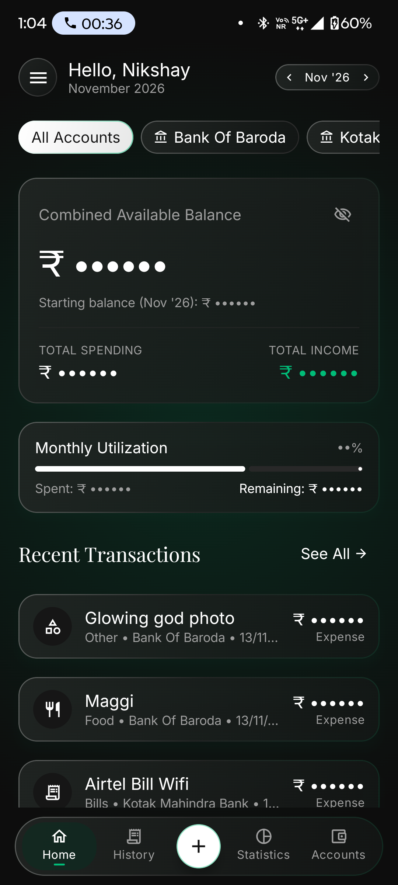
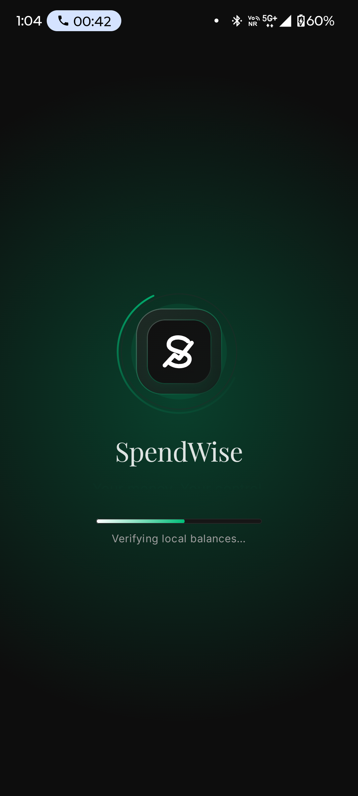
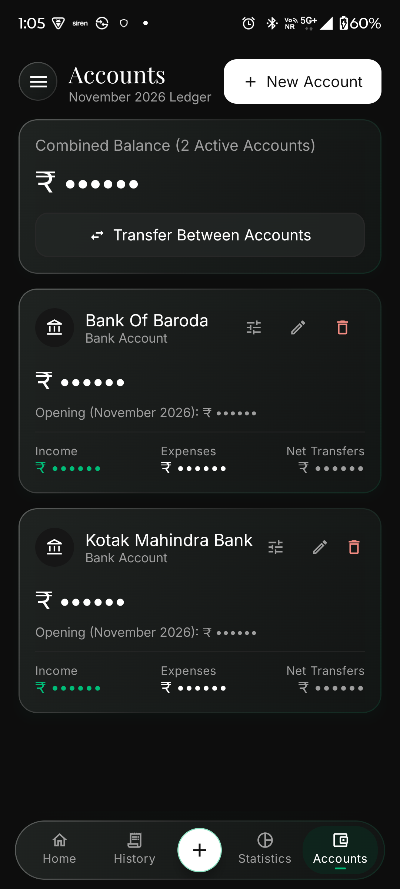
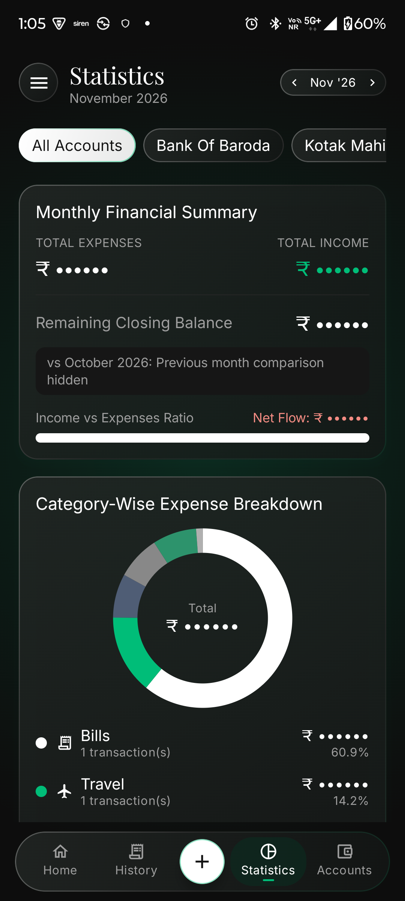
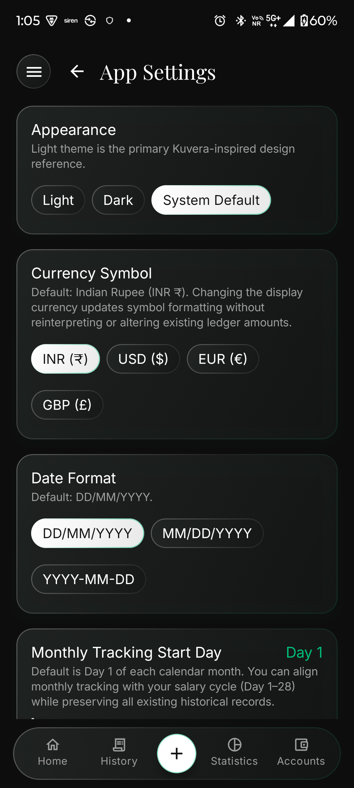
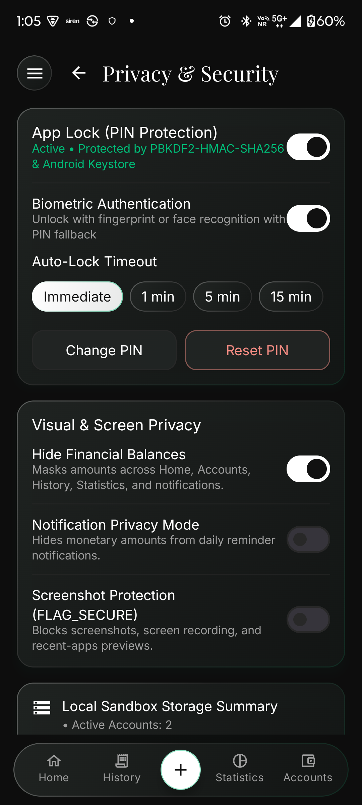
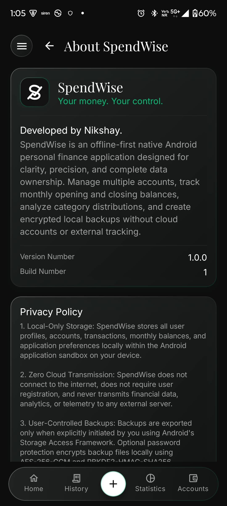
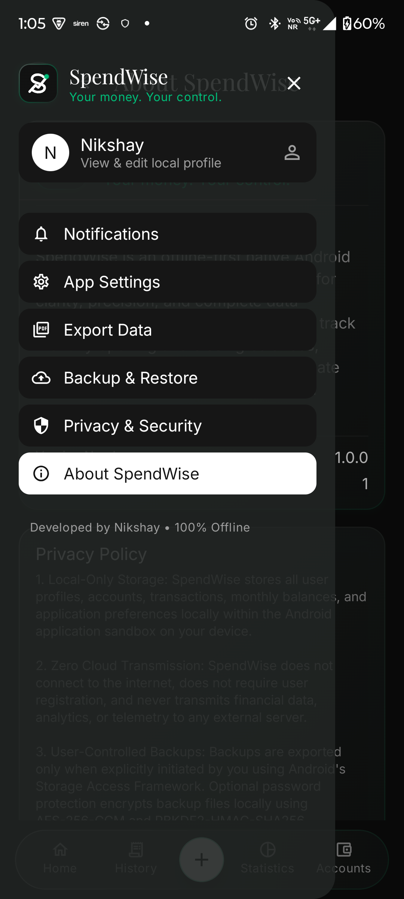

# SpendWise

### Your money. Your control.

**SpendWise** is an offline-first personal finance management application for Android, designed to give you complete control over your finances, with privacy, simplicity, and clarity at its core.

  

  <strong>Developed by Nikshay</strong>

---

## About SpendWise

SpendWise is a personal finance application that helps you manage multiple financial accounts, track income and expenses, monitor monthly balances, and understand your spending habits.

Built with an offline-first philosophy, SpendWise keeps your financial information locally on your device without requiring cloud accounts or external tracking.

## Features

- **Home Dashboard:** View combined balances, monthly utilization, income, expenses, and recent transactions.
- **Multiple Accounts:** Manage bank accounts and other financial accounts independently.
- **Transaction Management:** Record and organize income and expenses.
- **Monthly Ledger:** Track opening balances, closing balances, and monthly financial activity.
- **Statistics:** Analyze spending patterns and category-wise expense distributions.
- **Account Transfers:** Transfer money between your accounts.
- **Privacy Controls:** Hide financial balances and protect screenshots.
- **App Lock:** PIN protection and biometric authentication.
- **Backup & Restore:** Create and restore local backups with optional password protection.
- **Customizable Settings:** Configure currency, date format, appearance, and monthly tracking preferences.
- **Offline First:** Financial records are stored locally on your device.

## 📱 Application Screenshots

Explore the SpendWise interface, designed with a clean, modern dark aesthetic and an emerald-green accent.

  <strong>Home Dashboard</strong> 
  

  <strong>Application Splash Screen</strong> 
  

  <strong>Account Management</strong> 
  

  <strong>Financial Statistics</strong> 
  

  <strong>App Settings</strong> 
  

  <strong>Privacy & Security</strong> 
  

  <strong>About SpendWise</strong> 
  

  <strong>Navigation Drawer</strong> 
  

## Privacy & Security

SpendWise is designed around data ownership and local privacy.

- Financial records are stored within the Android application sandbox.
- No cloud account or user registration is required.
- Financial information is not transmitted to external servers.
- Backups are user-initiated.
- Optional password-protected backups use AES-256-GCM encryption and PBKDF2-HMAC-SHA256 key derivation.

## Download

**Latest version: 1.0.0**

The official Android APK will be available through the GitHub Releases section.

[Download SpendWise](../../releases/latest)

To install:
1. Download the APK.
2. Open the downloaded APK on your Android device.
3. Allow installation from this source if Android requests permission.
4. Complete installation and start managing your finances.

### ⚠️ Installation Note

SpendWise is distributed directly through GitHub and is not currently listed on the Google Play Store.

Google Play Protect may display an **"Unrecognized app"** warning when installing the APK downloaded from GitHub. This can happen with apps distributed outside Google Play.

If you see this warning, verify that you downloaded the APK from the official SpendWise repository before deciding whether to proceed with installation.

## (THE APP HAS PASSED THE PLAYSTORE SECUIRTY CHECKS)

**Official repository:** https://github.com/nikshay-64/SpendWise

## Application Information

| Detail | Information |
|---|---|
| Application | SpendWise |
| Version | 1.0.0 |
| Build Number | 1 |
| Platform | Android |
| Distribution | APK |
| Storage | Local device storage |
| Developer | Nikshay |

## Developer

**Developed by Nikshay.**

SpendWise is an independently developed personal finance management application.

## License & Usage

SpendWise is distributed as a compiled Android application. All rights to the application, branding, and associated assets are reserved by the developer unless explicitly stated otherwise.

The availability of this repository does not grant permission to redistribute modified versions or commercially exploit the application.

---

  **SpendWise**
  
  *Your money. Your control.*
  
  Developed by Nikshay.

